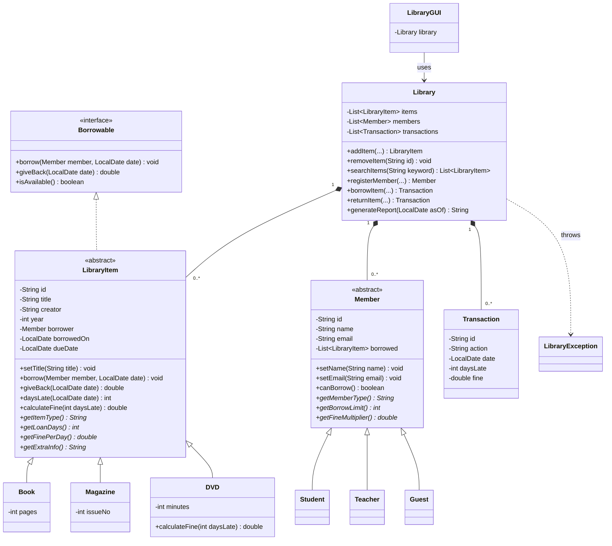

# Aklatan Library Management System

A Java Swing desktop application for a small school library. Staff can keep a catalog of books, magazines and DVDs, register members, lend and take back items, and see late fines and a summary report. It is built to demonstrate the four pillars of object-oriented programming.

Fines and borrowing limits depend on both the kind of item and the kind of member, so the same action gives different results for different objects. That is where the OOP design is used.

## Features

| # | Feature | Description |
|---|---------|-------------|
| 1 | Add and remove items | Book, Magazine or DVD with title, creator, year and a type-specific detail |
| 2 | Search the catalog | By title, creator, ID or type, not case-sensitive |
| 3 | Register members | Student, Teacher or Guest, with a valid, unique email |
| 4 | Borrow an item | Due date set by item type, borrow limit set by member type |
| 5 | Return an item | Works out days late and the fine, and prints a receipt |
| 6 | Transaction ledger | Every borrow and return with date, member and fine |
| 7 | Library report | Item and member counts, overdue items, total fines collected |
| 8 | Input validation | Blank fields, bad numbers, bad dates, duplicates and rule breaks show a clear message |

## Rules

| Item | Loan period | Fine per day late |
|------|-------------|-------------------|
| Book | 14 days | PHP 5.00 |
| Magazine | 7 days | PHP 3.00 |
| DVD | 3 days | PHP 20.00 (fine capped at PHP 300.00) |

| Member | Borrow limit | Fine rate |
|--------|--------------|-----------|
| Student | 3 items | full fine |
| Teacher | 6 items | half fine |
| Guest | 1 item | double fine |

A member with an overdue item cannot borrow again until it is returned.

## Object-Oriented Design

### Encapsulation
Every field is `private`. Fields change only through setters that check the value first, for example `setTitle` rejects a blank title and `setYear` rejects a year outside 1000 to next year. `Transaction` is immutable.

### Inheritance
- `LibraryItem` is the parent of `Book`, `Magazine` and `DVD`.
- `Member` is the parent of `Student`, `Teacher` and `Guest`.
- `LibraryException` extends `Exception`.

### Polymorphism
`giveBack()` calls `calculateFine()`, `getFinePerDay()` and `getFineMultiplier()` on whatever object it has, with no `if` on the type. `DVD` overrides `calculateFine()` to add the PHP 300.00 cap.

### Abstraction
- `Borrowable` is an interface with `borrow`, `giveBack` and `isAvailable`.
- `LibraryItem` and `Member` are abstract classes. Each child fills in the abstract methods such as `getLoanDays()` and `getBorrowLimit()`.

## Class Diagram



## Project Structure

```
LibrarySystem/
├── Main.java               Entry point, loads sample data, opens the window
├── LibraryGUI.java         Swing window (Catalog, Members, Circulation, Ledger tabs)
├── Library.java            Holds all data and enforces every rule
├── Borrowable.java         Interface
├── LibraryItem.java        Abstract class
├── Book.java               Magazine.java       DVD.java
├── Member.java             Abstract class
├── Student.java            Teacher.java        Guest.java
├── Transaction.java        One ledger line
├── LibraryException.java   Custom exception for rule violations
└── LibraryTests.java       21 console tests
```

## How to Run

Requires Java 11 or newer.

```
cd LibrarySystem
javac *.java
java Main
```

To run the tests:

```
java LibraryTests
```

Expected result: `21 passed, 0 failed`.

## Testing

`LibraryTests.java` builds a fresh library for each case and checks the result against the rules above. It covers valid and invalid input, duplicates, borrow limits, overdue blocking, due dates, fines for each member and item type, the DVD fine cap, on-time returns and search.
